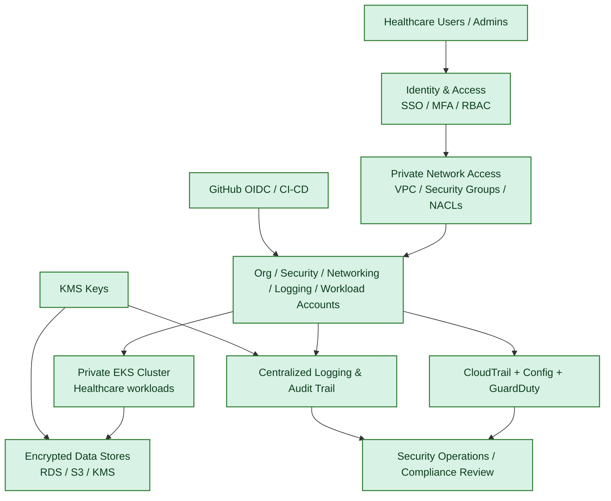

# Healthcare Zero-Trust Platform

A secure, multi-account AWS healthcare platform blueprint designed around zero-trust architecture principles, least privilege access, and strong auditability. The repository models a production-oriented foundation for healthcare workloads using Terraform, security guardrails, and automated validation.

## Overview

This project provisions a secure AWS landing zone for healthcare workloads with:

- Separate AWS accounts for organization, security, networking, logging, and workload isolation
- Private EKS cluster design with network segmentation
- KMS-backed encryption for logs and platform resources
- CloudTrail, AWS Config, and GuardDuty integration
- GitHub OIDC-based CI/CD trust model
- Infrastructure-as-code validation and policy checks

## Zero-trust architecture overview



## Security principles

The implementation is aligned with common healthcare and zero-trust expectations:

- Least privilege IAM design
- Private-only connectivity to compute workloads
- Centralized log collection and retention controls
- Enforced encryption at rest and in transit
- Strong public access blocking and bucket hardening
- Audit-ready baseline controls for compliance-oriented environments

## Repository structure

```text
.
├── .github/workflows/          # CI validation workflow
├── docs/                       # Architecture and compliance notes
├── kubernetes/                 # Kubernetes manifests and policy references
├── references/                 # Reference architectures and material
├── scripts/                    # Operational and automation scripts
├── security/                   # Security workflows and checks
├── validation/                 # Safe Terraform validation environment
├── terraform/
│   ├── live/landing-zone/      # Landing zone deployment entry points
│   └── modules/               # Reusable Terraform modules
├── tests/validation/           # Architecture and security validation tests
├── .gitignore
├── README.md
└── ...
```

## Key platform components

### AWS landing zone

The Terraform structure includes orchestration for:

- Org baseline
- Network account
- Security account
- Logging account
- Workload account
- GitHub OIDC trust configuration

### EKS and platform security

The EKS platform layer includes:

- VPC networking and segmentation
- KMS-managed encryption
- GuardDuty setup
- CloudTrail and Config support
- Identity and access controls for cluster operations

### Simulation and validation

The repo includes a validation environment that checks architecture and security logic without creating real cloud resources. Automated tests cover:

- no real AWS resources created during simulation
- successful Terraform plan execution
- encryption requirements
- audit logging
- private EKS expectations
- multi-account structure validation
- security monitoring requirements

## Validation status

The project was validated with:

- Terraform formatting and validation
- Terraform plan validation in simulation mode
- Checkov security scanning
- Python unit tests for the simulation layer

Representative results include:

- Checkov: 429 passed, 0 failed, 0 skipped
- Simulation tests: 7 passed

## Quick start

1. Install Terraform and Python.
2. Review the validation configuration in `validation/`.
3. Run security and validation checks:

```bash
terraform fmt -recursive terraform
terraform -chdir=validation init -backend=false
terraform -chdir=validation validate
terraform -chdir=validation plan -input=false
python3 -m unittest discover -s tests/validation -v
checkov -d terraform --framework terraform --compact --quiet
```

## Notes

This repository is intended as a reference architecture and validation-oriented implementation for secure healthcare platform design. It should be reviewed and adapted for your specific environment, compliance requirements, and operating model before production use.

## Repository

- GitHub: https://github.com/RashidKhokhar/healthcare-zero-trust-platform
